<!-- Hero Anime Banner (Local SVG: zero external dependency, animated sakura & clouds) -->

  

<!-- Typing Subtitle -->

  

<!-- Social & Contact Badges -->

  
  
  
  
  

---

### 🌸 关于我 · About Me

- 💻 **开发方向**：后端开发（`Golang` ）与 **AI / Agent** 应用探索
- 🤖 **当前关注**：LLM 工作流、AI-Agent、AI-Memory、MCP 生态与开发者效率工具
- ☁️ **常用工具**：Docker、Git、Markdown、WordPress 等
- 🎧 **日常爱好**：二次元 / ACG 爱好者，偶尔在 [B站 · 林殇葵](https://space.bilibili.com/43964072) 摸鱼出没
- 💌 **交流合作**：欢迎在 GitHub 提 Issue / PR，或通过 B 站、QQ 交流！

---

### 🛠️ 技术栈 · Tech Stack

  <picture>
    <source media="(prefers-color-scheme: dark)" srcset="https://skillicons.dev/icons?i=go,py,c,docker,git,md,wordpress&theme=dark" />
    <source media="(prefers-color-scheme: light)" srcset="https://skillicons.dev/icons?i=go,py,c,docker,git,md,wordpress&theme=light" />
    
  </picture>

  
  
  
  
  

---

### 📊 数据一览 · GitHub Stats

  
  

  

  

  
✨ 展开查看完整 GitHub Metrics 详细报告

   
  

---

### 🐍 贡献贪吃蛇 · Contribution Snake

  <picture>
    <source media="(prefers-color-scheme: dark)" srcset="https://raw.githubusercontent.com/knoci/knoci/output/github-contribution-grid-snake-dark.svg" />
    <source media="(prefers-color-scheme: light)" srcset="https://raw.githubusercontent.com/knoci/knoci/output/github-contribution-grid-snake.svg" />
    
  </picture>

<!-- Matching Fresh Anime Footer -->

  

